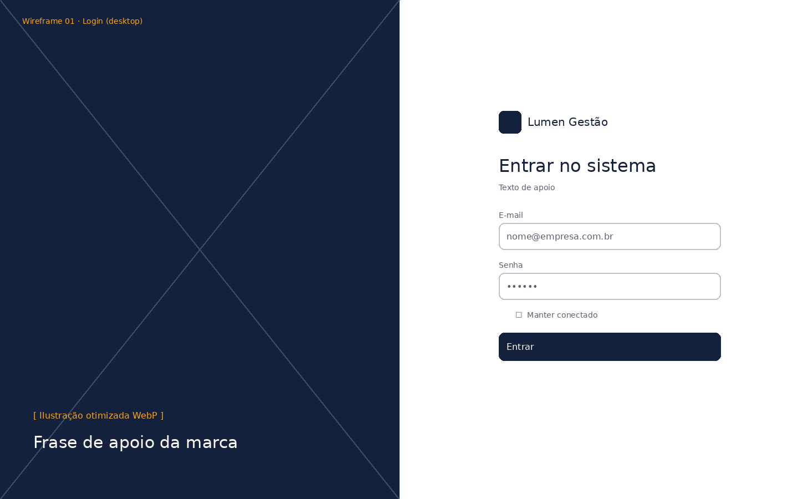
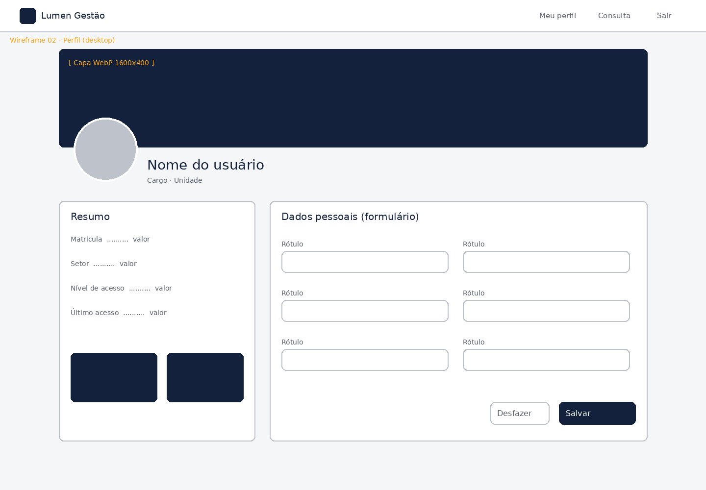
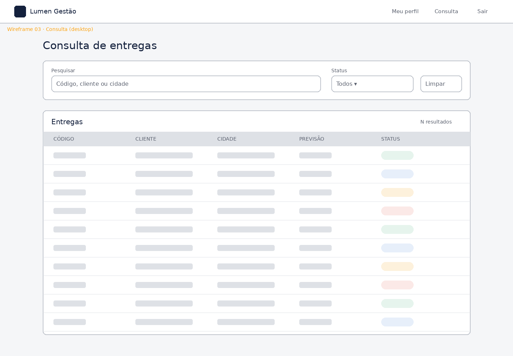

# Lumen Gestão · Situação de Aprendizagem 02

Interface inicial de um sistema web interno para a **Lumen Logística**, cliente fictício da NovaWeb Studio. O módulo cobre o acesso ao sistema, o perfil do usuário e a consulta de entregas.

Projeto individual desenvolvido em HTML, CSS e JavaScript, com Bootstrap 5 para o grid responsivo.

## Telas

| Tela | Arquivo | O que tem |
| --- | --- | --- |
| Login | `index.html` | Formulário de autenticação com validação, mostrar/ocultar senha, "manter conectado" e mensagem de erro |
| Perfil | `pages/perfil.html` | Capa, foto, resumo do usuário, indicadores e formulário de dados pessoais com validação e máscara de telefone |
| Consulta | `pages/consulta.html` | Tabela de entregas com pesquisa por texto, filtro por status, contador de resultados e aviso quando nada é encontrado |

## Como abrir

1. Clone o repositório ou baixe a pasta.
2. Abra no VS Code e use a extensão **Live Server** (botão "Go Live"), ou abra o `index.html` direto no navegador.
3. Entre com o acesso de demonstração:
   - E-mail: `ana@lumen.com.br`
   - Senha: `lumen123`

As páginas internas verificam se existe sessão. Quem tenta abrir `perfil.html` ou `consulta.html` sem fazer login volta para a tela de entrada.

## Estrutura de pastas

```
.
├── index.html                 # Tela de login
├── pages/
│   ├── perfil.html            # Perfil do usuário
│   └── consulta.html          # Tabela + pesquisa
├── assets/
│   ├── css/style.css          # Toda a estilização (CSS externo)
│   ├── js/
│   │   ├── login.js           # Validação e autenticação de demonstração
│   │   ├── sessao.js          # Proteção das páginas internas e logout
│   │   ├── perfil.js          # Formulário do perfil
│   │   └── consulta.js        # Filtro visual da tabela
│   └── img/                   # Imagens otimizadas (WebP + JPG) e logo SVG
└── docs/
    └── prototipo/             # Wireframes das telas (desktop e mobile)
```

## Protótipo

Antes de programar, as telas foram planejadas em wireframes de baixa fidelidade, em versão desktop e mobile. Eles estão em [`docs/prototipo`](docs/prototipo) e foram usados como base no Figma.

**Link do Figma:** _cole aqui o link do seu arquivo_

| Login | Perfil | Consulta |
| --- | --- | --- |
|  |  |  |

## Identidade visual

| Elemento | Valor | Uso |
| --- | --- | --- |
| Azul-marinho | `#14213D` | Cor principal, botões, títulos |
| Âmbar | `#FCA311` | Destaques e detalhes da marca |
| Fundo | `#F5F6F8` | Fundo das páginas internas |
| Texto | `#1B1F24` / `#5B6472` | Texto principal e secundário |
| Títulos | Space Grotesk | Personalidade e leitura rápida |
| Texto | Inter | Boa legibilidade em formulários e tabelas |

As cores, fontes, raios de borda e sombras ficam em variáveis CSS no início do `style.css`. Assim qualquer ajuste de identidade é feito em um lugar só.

Os status da tabela usam cores com significado: verde para entregue, azul para em rota, amarelo para pendente e vermelho para atrasado. O texto do status sempre aparece junto, então a informação não depende só da cor.

## Otimização de imagens

As imagens foram geradas em alta resolução e depois exportadas em dois tamanhos e dois formatos. O navegador escolhe sozinho a melhor versão com `<picture>`, `srcset` e `sizes`.

| Imagem | Original (PNG) | Versão usada | Tamanho final | Redução |
| --- | --- | --- | --- | --- |
| Ilustração do login | 2400×2800 · 236 KB | 960 px WebP | 17,9 KB | 92% |
| Ilustração do login (celular/tela menor) | | 480 px WebP | 7,3 KB | 97% |
| Capa do perfil | 3200×800 · 48 KB | 1600 px WebP | 9,0 KB | 81% |
| Capa do perfil (celular) | | 800 px WebP | 3,8 KB | 92% |
| Avatar | 1024×1024 · 8,6 KB | 128 px WebP | 0,9 KB | 90% |
| Logo | | SVG | 0,3 KB | vetor |

Decisões:

- **WebP** como formato principal porque gera arquivos bem menores que JPG na mesma qualidade. O **JPG** fica como reserva para navegadores antigos.
- **Dimensões próximas do tamanho exibido**. Não faz sentido baixar 2400 px para mostrar 700 px.
- **Versão 2x do avatar** para telas retina, carregada só quando necessário.
- **`width` e `height` em todas as imagens** para o navegador reservar o espaço e a página não "pular" enquanto carrega.
- **Logo em SVG** porque é vetor: fica nítido em qualquer tamanho e pesa menos de 1 KB.
- **Ilustração do login escondida no celular** (`d-none d-lg-flex`). No celular o foco é o formulário.

## Justificativas técnicas

- **CSS externo e organizado por seções.** Nenhum estilo inline. O arquivo é dividido em variáveis, base, componentes e uma seção por tela.
- **Bootstrap só para grid e utilitários.** O visual é todo personalizado no `style.css`, então o sistema não fica com cara de template.
- **Formulários acessíveis.** Todo campo tem `label` ligado por `for`, tipos corretos (`email`, `tel`, `password`, `search`), `autocomplete`, mensagens de erro ligadas por `aria-describedby` e alertas com `aria-live`. No perfil os campos são agrupados com `fieldset` e `legend`.
- **Validação com a API nativa do HTML** (`required`, `minlength`, `pattern`, `checkValidity`). O JavaScript só cuida de mostrar os erros no momento certo.
- **Tabela responsiva de verdade.** No celular cada linha vira um cartão, usando o atributo `data-rotulo` para mostrar o nome da coluna. Isso evita a rolagem lateral, que é ruim de usar no toque.
- **Pesquisa sem acento.** O filtro normaliza o texto, então "sao jose" encontra "São José do Rio Preto".
- **Foco visível** em todos os elementos interativos, para quem navega pelo teclado.

## Problemas encontrados e soluções

| Problema | Análise | Solução |
| --- | --- | --- |
| Texto do login difícil de ler sobre a ilustração | Os pontos da imagem caíam atrás do título | Degradê escuro sobre a parte de baixo da imagem com `::after` |
| Tabela apertada no celular | Cinco colunas não cabem em 390 px | Linhas viram cartões abaixo de 576 px |
| Páginas internas abriam sem login | Não havia checagem de sessão | `sessao.js` redireciona para o login quando não há sessão |
| Ícone de erro do Bootstrap sobrepunha o botão "Mostrar" | O ícone e o botão ocupavam o mesmo canto | Ícone removido só no campo de senha |

## Planejamento

| Etapa | Entrega |
| --- | --- |
| 1 | Leitura do briefing e definição do cliente e da identidade visual |
| 2 | Wireframes e protótipo das três telas |
| 3 | Estrutura de pastas e páginas HTML |
| 4 | Estilização com CSS e responsividade |
| 5 | Otimização das imagens |
| 6 | Interações em JavaScript (login, perfil, filtro) |
| 7 | Testes em desktop e celular, ajustes e documentação |

O histórico de commits mostra a evolução do projeto etapa por etapa.

## Tecnologias

HTML5 · CSS3 · JavaScript · Bootstrap 5.3 · Google Fonts · Git e GitHub · VS Code

---

Desenvolvido por **Matheus** · Desenvolvimento de Software Multiplataforma · Fatec Olímpia
